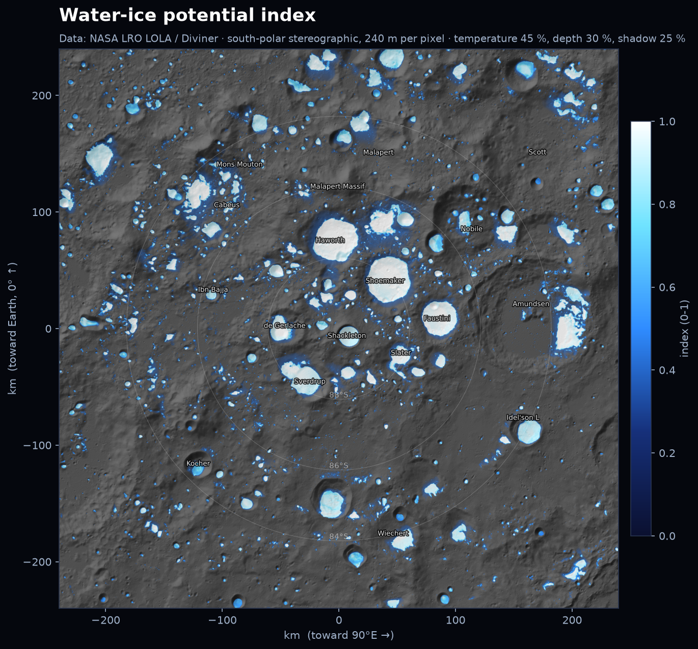
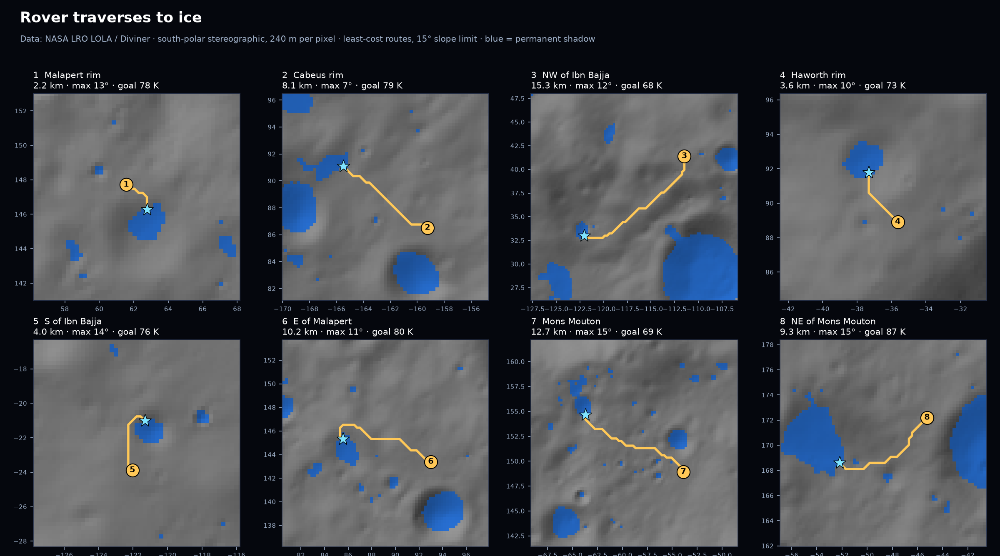

# Chhaya Drishti — Lunar South Pole Water-Ice Mapping and Rover Path Planning

*Chhaya Drishti (छाया दृष्टि) means "shadow vision".*

An end-to-end analysis of where water ice can survive at the Moon's south pole, where a lander can safely touch down, and how a rover can drive from the landing site to the ice — presented as an interactive 3D website.



## What is in this repository

| Folder | Contents |
| --- | --- |
| `pipeline/` | Python analysis, one script per step (terrain → shadow and ice → landing and rover) |
| `web/` | The interactive 3D website (three.js + Vite) with the processed data it needs |
| `outputs/maps/` | Static PNG maps of every deliverable |
| `data/` | Downloaded source data and intermediate arrays (git-ignored, re-created by the pipeline) |

## The three stages

### Stage 1 — Terrain
Elevation, slope and hillshade from laser altimetry on a 240 m grid covering 228,944 km² around the pole (to 82.1°S). Slope is measured on the 80 m model and summarised per cell. Total relief is 13.7 km.

### Stage 2 — Shadow and ice
- **Permanently shadowed regions (PSRs).** For each of the 4 million cells the terrain horizon is traced in 120 directions on a spherical Moon, then the Sun is swept through a full lunar day at every season. A cell is permanently shadowed if no part of the solar disc ever clears its horizon. Result: **16,874 km²** of permanent shadow.
- **Validation.** The PSR map agrees with NASA's published LOLA PSR product on **99.56 %** of cells (IoU 0.94). Average sunlight correlates at r = 0.996 and Earth visibility at r = 0.992.
- **Temperature.** Annual maximum surface temperature and depth to thermally stable ice from the Diviner radiometer. The coldest surface in the area is about 27 K.
- **Ice potential index** = 0.45 × temperature score + 0.30 × subsurface-stability score + 0.25 × permanent-shadow score. **11,514 km²** are both permanently shadowed and colder than 110 K.

### Stage 3 — Landing and rover
- **Landing suitability** = 0.30 safety + 0.30 science + 0.25 power + 0.15 comms, after hard exclusions (permanent shadow, under 25 % sunlight, less than 85 % of a 500 m footprint below 10°, more than 6° from the pole). 7.2 % of the area qualifies; the eight best separated sites are ranked.
- **Rover routes** are least-cost paths (A* / Dijkstra). Cost = distance × (1 + (slope / 10°)²) × (1 + shadow avoidance × darkness); cells above the slope limit are impassable. Every ranked site reaches an ice target within 2–15 km.

## The website

- **Orbit** — a textured Moon globe with Chandrayaan-3, Chandrayaan-2, LCROSS and IM-1 marked, and a camera dive to the pole.
- **01 Terrain** — real 3D terrain with relief, elevation, slope and hillshade layers, contours, lat/lon grid, vertical exaggeration and a cross-section tool.
- **02 Shadow & Ice** — live sunlight with shadows ray-marched on the GPU; drag the lunar-day and season sliders or press play. PSR outlines (with the NASA reference for comparison), temperature, ice depth and the ice index.
- **03 Landing & Rover** — suitability map, ranked sites, and a route planner that runs in the browser: pick a site, or click anywhere to route to the nearest ice or between two points, then change the slope limit and shadow avoidance to replan. Includes a traverse profile and rover playback.

### Run it

Requires [Node.js](https://nodejs.org) 18 or newer.

```bash
cd web
npm install
npm run dev
```

Then open http://127.0.0.1:5173. On Windows you can instead double-click `start-website.bat`.

To build a static copy for hosting (GitHub Pages, Netlify, Vercel — all free): `npm run build`, then upload `web/dist/`.

The processed data the site needs (about 27 MB) is already in `web/public/`, so the pipeline does not have to be run first.

## Re-running the analysis

Requires Python 3.10 or newer.

```bash
pip install -r pipeline/requirements.txt
python pipeline/run_all.py
```

The first run downloads about 0.9 GB of source data. The illumination step takes about 15 minutes on a 12-core laptop; the rest takes a few minutes.

| Script | Step |
| --- | --- |
| `s00_download.py` | Fetch the source datasets |
| `s01_terrain.py` | Elevation, slope, roughness, hillshade |
| `s02_illumination.py` | PSRs, average sunlight, Earth visibility, validation |
| `s03_diviner.py` | Grid Diviner temperature and ice-depth data |
| `s04_ice.py` | Ice potential index and PSR catalogue |
| `s05_landing.py` | Landing suitability and site ranking |
| `s06_paths.py` | Rover routes from each site to ice |
| `s07_export.py` | Textures and metadata for the website |
| `s08_maps.py` | Static PNG maps |

## Data

All inputs are free, public-domain NASA Lunar Reconnaissance Orbiter (LRO) products that need no account.

| Dataset | Used for |
| --- | --- |
| [LOLA polar DEMs](https://pds-geosciences.wustl.edu/missions/lro/lola.htm), 240 m and 80 m | Elevation, slope, shadow modelling, routing |
| [Diviner Polar Resource Product](https://pds-geosciences.wustl.edu/missions/lro/diviner.htm) | Maximum temperature, depth to stable ice |
| [LOLA illumination and PSR maps](https://pgda.gsfc.nasa.gov/products/69) | Independent check of the shadow model |
| [NASA SVS CGI Moon Kit](https://svs.gsfc.nasa.gov/4720) | Global colour and relief for the orbit view |

**Why not Chandrayaan-2?** Chandrayaan-2 products (TMC-2 terrain, OHRC imagery, DFSAR radar) are free but distributed through ISRO's [PRADAN portal](https://pradan.issdc.gov.in), which requires a registered account and provides individual orbit strips rather than a seamless polar mosaic. LRO provides the same kinds of measurement as ready-made polar grids. The method does not depend on the sensor: a Chandrayaan-2 DEM in the same projection can replace the LOLA file in `s01_terrain.py`.

## Deliverables

| Map | File |
| --- | --- |
| Elevation | `outputs/maps/01_elevation.png` |
| Slope | `outputs/maps/02_slope.png` |
| Hillshade | `outputs/maps/03_hillshade.png` |
| Permanently shadowed regions | `outputs/maps/04_psr.png` |
| Water-ice potential | `outputs/maps/05_ice_potential.png` |
| Landing-site suitability | `outputs/maps/06_landing_suitability.png` |
| Rover traverses | `outputs/maps/07_rover_routes.png` |
| 2D and 3D visualisation | the website |



## Limits

- The ice map shows where ice *can persist* (thermal and illumination stability). It is not a detection of ice.
- At 240 m per cell, boulders and small craters are invisible. A real mission would re-check a chosen site with metre-scale imagery.
- Drive times assume continuous driving at 10 cm/s and ignore charging and communication stops.
- The Diviner "depth to stable ice" values are a thermal-model product, not a measurement of buried ice.

## Future scope

- Add Chandrayaan-2 DFSAR and LRO Mini-RF radar as a direct ice indicator.
- Machine-learning classification of ice-bearing terrain.
- Time-aware routing that keeps the rover in sunlight as shadows move.
- Metre-scale hazard detection from OHRC / LROC NAC imagery.

## References

- Mazarico, E. et al. (2011). Illumination conditions of the lunar polar regions using LOLA topography. *Icarus* 211.
- Paige, D. A. et al. (2010). Diviner Lunar Radiometer observations of cold traps in the Moon's south polar region. *Science* 330.
- Smith, D. E. et al. (2010). The Lunar Orbiter Laser Altimeter investigation on the LRO mission. *Space Science Reviews* 150.
- Colaprete, A. et al. (2010). Detection of water in the LCROSS ejecta plume. *Science* 330.
- ISRO Chandrayaan-2 mission and data archive (ISSDC PRADAN).

## Team

Tha Hack Pack
